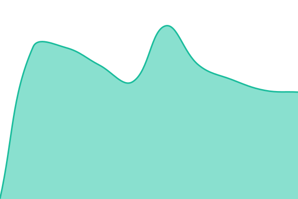

# [📈 Live Status](https://jglopesdev.github.io/status-chav): <!--live status--> **Todos os sistemas estão funcionando**

This repository contains the open-source uptime monitor and status page for [João Lopes](https://jglopes.dev), powered by [Upptime](https://github.com/upptime/upptime).

With [Upptime](https://upptime.js.org), you can get your own unlimited and free uptime monitor and status page, powered entirely by a GitHub repository. We use [Issues](https://github.com/jglopesdev/status-chav/issues) as incident reports, [Actions](https://github.com/jglopesdev/status-chav/actions) as uptime monitors, and [Pages](https://jglopesdev.github.io/status-chav) for the status page.

<!--start: status pages-->
<!-- This summary is generated by Upptime (https://github.com/upptime/upptime) -->
<!-- Do not edit this manually, your changes will be overwritten -->
<!-- prettier-ignore -->
| URL | Status | History | Response Time | Uptime |
| --- | ------ | ------- | ------------- | ------ |
|  [Chav — site](https://grupocomeri.chav.io/api/health) | No ar | [chav-site.yml](https://github.com/jglopesdev/status-chav/commits/HEAD/history/chav-site.yml) | 

 565ms
     
 | 

<a href="https://jglopesdev.github.io/status-chav/history/chav-site">89.44%</a>
    

|  [Chav — cópias](https://grupocomeri.chav.io/api/chav/saude/copias) | No ar | [chav-copias.yml](https://github.com/jglopesdev/status-chav/commits/HEAD/history/chav-copias.yml) | 

 527ms
     
 | 

<a href="https://jglopesdev.github.io/status-chav/history/chav-copias">89.63%</a>
    

<!--end: status pages-->

[**Visit our status website →**](https://jglopesdev.github.io/status-chav)

## 📄 License

- Powered by: [Upptime](https://github.com/upptime/upptime)
- Code: [MIT](./LICENSE) © [Anand Chowdhary](https://anandchowdhary.com)
- Data in the `./history` directory: [Open Database License](https://opendatacommons.org/licenses/odbl/1-0/)
